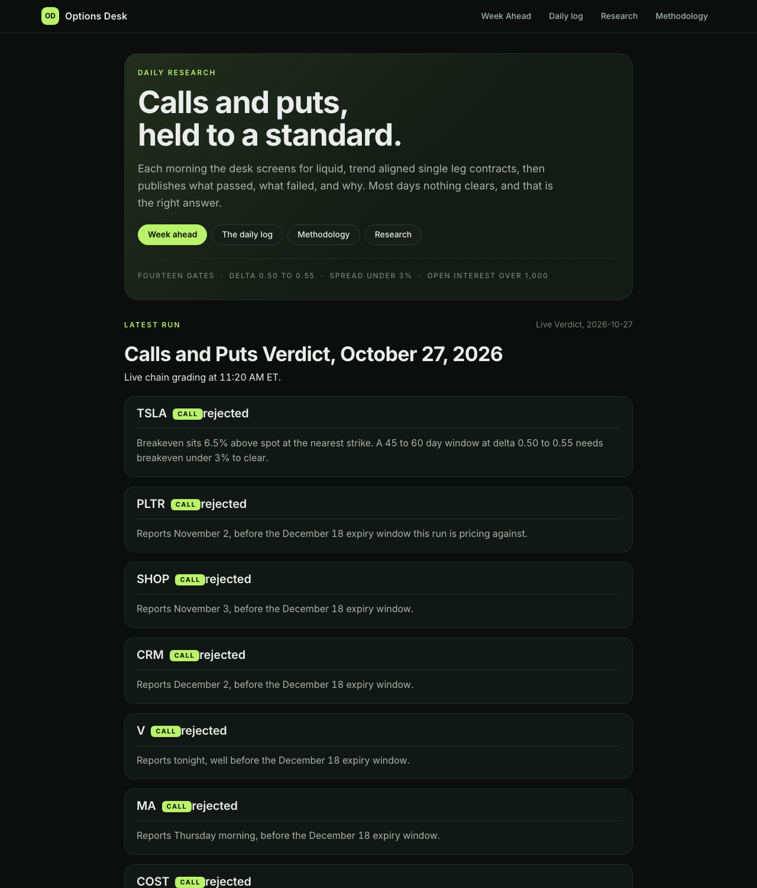
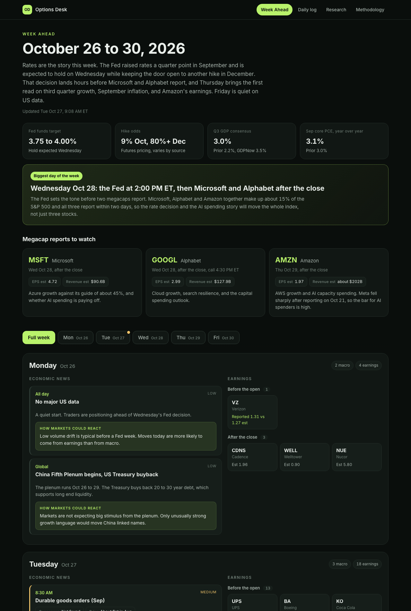

# Options Desk

**A daily research desk for single leg calls, built to be tested and to say "no" most days.**

## What it is

Every weekday two automated passes screen the S&P 500 for liquid, trend aligned call options, then publish what passed, what failed and why. Most days nothing clears, and that is the intended result. Nothing here is a trade recommendation, it is a public research log.

| Run | Time, ET | Output |
|---|---|---|
| Premarket plan | 8:36 | Candidates with trend check, dated catalyst and a provisional contract |
| Live verdict | 10:11 | The same candidates regraded on live chains, with entry, stop and target |

When a contract clears every gate, its heading gets a **View more** card that shows the dollar gain or loss for one contract at a range of stock moves.

## The rules today

Fourteen gates, all of which must pass. The reason behind each one is on the [methodology page](https://carolinehutchins05-prog.github.io/options-desk/methodology).

- **Calls only**, and only while the S&P 500 is above its 200 day average. Puts are suspended.
- **Trend:** price above a rising 50 day average, RSI between 45 and 70, no 52 week high in the last three sessions.
- **Contract:** 45 to 60 days to expiry, delta 0.50 to 0.55, spread 3% of the mark or less, open interest 1,000 or more, volume 500 or more, bid and ask size 20 or more.
- **Event risk:** earnings must fall after expiry.
- **Exit:** plus 50% on the contract, five days, or a stop at 50% down on a close.

## Tested against the S&P 500

The rules were backtested on 503 S&P 500 stocks over ten years, with the index as the benchmark. The honest summary:

- The trend gate alone matched the index, so it is a filter and not an edge.
- Trend based puts lost money in both halves of the sample and are now off.
- After costs the calls come out near breakeven, and the spread is what decides it.
- The current rules shrink the worst trades and lose less, but the gain is small and not proven.

Option prices in the test are modeled, because free historical option chains do not exist. The write up lists every limit. Code and results are in [`backtest/`](backtest).

## Week ahead

A dashboard of the week's economic releases, earnings reports and how markets could react, refreshed every Sunday evening and Wednesday morning.

## What is in the repo

| Path | What it is |
|---|---|
| `index.md`, `methodology.md`, `research/` | The site pages |
| `archive/` | Every daily run, generated |
| `week-ahead.html`, `data/week.json` | The Week Ahead page and the data it is built from |
| `backtest/` | Backtest code and results |
| `assets/` | Stylesheets |
| `publish.sh`, `publish_week.sh` | Publishers, with automatic redaction and a credential check |
| `build_week.py`, `options_card.py`, `clean_for_web.py` | Page builders |

Built with Jekyll on GitHub Pages and plain Python. No framework, no tracking.

## Privacy

The publishers strip anything about positions, holdings, sizing or accounts before writing a page, and refuse to push if they find an account number or credential. No position, account or portfolio data is published here.

## Not investment advice

A personal research log. Nothing here is a recommendation to buy or sell anything.
